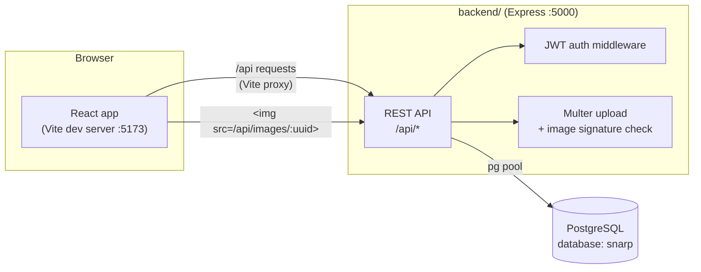
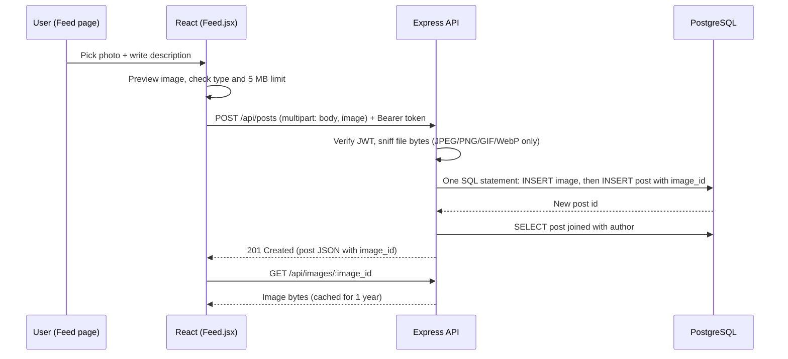
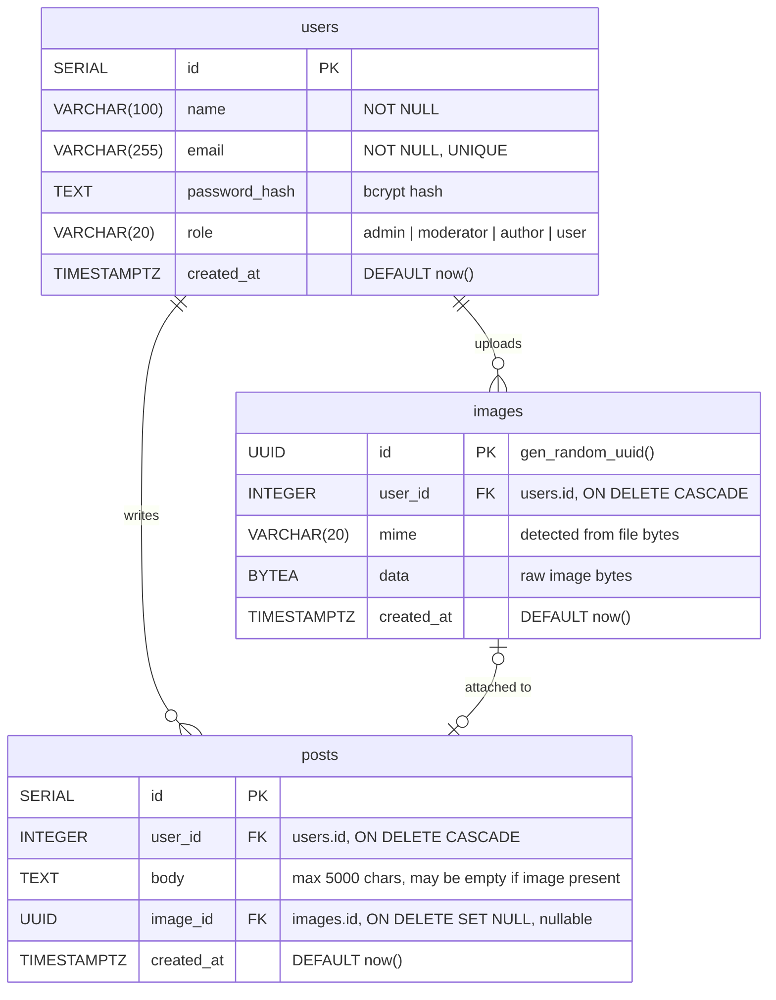

# SNARP: Social Networking & Academic Research Platform

An UptoSkills internship MVP where students and researchers share updates, publish research and connect with communities.

This README describes the project **as it stands today**: what works end to end, what is UI only, and how to run it.

---

## Contents

- [Current status](#current-status)
- [Tech stack](#tech-stack)
- [Architecture](#architecture)
- [Getting started](#getting-started)
- [Database schema](#database-schema)
- [API reference](#api-reference)
- [Project structure](#project-structure)
- [Design system](#design-system)
- [Security notes](#security-notes)
- [Testing](#testing)
- [Roadmap and known limitations](#roadmap-and-known-limitations)

---

## Current status

| Feature | Status | Notes |
|---|---|---|
| Landing page | ✅ Working | GSAP scroll animations, shown to logged-out visitors at `/` |
| Sign up / log in / log out | ✅ Working | bcrypt password hashing, JWT (7 day expiry), "Keep me logged in" |
| Feed: create text posts | ✅ Working | Up to 5000 characters |
| Feed: post images with a description | ✅ Working | JPEG, PNG, GIF, WebP up to 5 MB, stored in PostgreSQL as `BYTEA` |
| Feed: delete your own post | ✅ Working | Also deletes the post's image |
| Citation tools (APA / BibTeX) | ✅ Working | Runs in the browser, needs no backend |
| Communities, Research papers, Events | 🎨 UI only | Sample data, join/register buttons toggle locally |
| Messages, Notifications | 🎨 UI only | Sample conversations and alerts |
| Submit a paper, Moderation queue | 🎨 UI only | Forms and approve/reject buttons work locally, nothing is saved |
| Settings, Help center | 🎨 UI only | FAQ and contact details are real |
| Search bar | 🎨 UI only | Searches the sample papers, communities and events |
| Like / Comment / Share on posts | 🎨 UI only | Like toggles locally and resets on refresh |

All sample content lives in one file, [`src/sample.js`](src/sample.js), so each list can be replaced with an API call when its backend is built.

---

## Tech stack

| Layer | Technology |
|---|---|
| Frontend | React 19, Vite, React Router 7, GSAP 3 (ScrollTrigger, ScrollSmoother, SplitText, DrawSVG, Flip), Phosphor Icons (app), Hugeicons (landing), Geist font (self-hosted) |
| Backend | Node.js 22.9+ (tested on 24), Express 5 |
| Database | PostgreSQL (all data, including images, lives here) |
| Auth | JWT (`jsonwebtoken`) and `bcryptjs` |
| Uploads | Multer (in-memory) with file-signature validation |

No external storage (Cloudinary, S3, R2) is used. **Everything is stored in PostgreSQL.**

---

## Architecture



- In development, Vite proxies every `/api` request to `http://localhost:5000` (see [`vite.config.js`](vite.config.js)), so there are no CORS issues.
- **The backend sets itself up on start.** It connects to the `postgres` maintenance database, creates the `snarp` database if it does not exist, then creates or upgrades the tables. If everything already exists, it does nothing.
- On first start, the backend generates a random `JWT_SECRET` and saves it to `backend/.env`.

### Request flow: creating an image post



---

## Getting started

### Prerequisites

- **Node.js 22.9 or newer** (the backend uses `--env-file-if-exists`)
- **PostgreSQL** running locally (any recent version with `gen_random_uuid()`, so 13+)

### 1. Install dependencies

```bash
# frontend (project root)
npm install

# backend
cd backend
npm install
```

### 2. Configure the database connection

```bash
cd backend
cp .env.example .env
```

Edit `backend/.env`:

```env
PGHOST=localhost
PGPORT=5432          # check your postgresql.conf, some installs use 5433 or 5434
PGUSER=postgres
PGPASSWORD=your_password
PGDATABASE=snarp     # created automatically if it does not exist
PORT=5000
# JWT_SECRET is generated automatically on first run
```

> Forgot your postgres password? See [Resetting the postgres password](#resetting-the-postgres-password).

### 3. Run

Use two terminals:

```bash
# Terminal 1: backend
cd backend
npm start            # or: npm run dev (restarts on file changes)
```

On the first run you should see:

```
Created database snarp
API running on http://localhost:5000
```

```bash
# Terminal 2: frontend (project root)
npm run dev
```

Open **http://localhost:5173**, create an account, and post.

### Available scripts

| Where | Command | What it does |
|---|---|---|
| root | `npm run dev` | Start the Vite dev server |
| root | `npm run build` | Production build into `dist/` |
| root | `npm run lint` | ESLint over frontend and backend |
| root | `npm test` | Citation generator tests |
| backend | `npm start` | Start the API |
| backend | `npm run dev` | Start the API with auto-restart |
| backend | `npm test` | Image signature tests |

### Resetting the postgres password

1. Open `C:\Program Files\PostgreSQL\<version>\data\pg_hba.conf` as Administrator.
2. Change `scram-sha-256` to `trust` on the `127.0.0.1/32` and `::1/128` lines, then restart the service (`Restart-Service postgresql-x64-<version>` in an admin PowerShell).
3. Run `psql -U postgres -p <port> -c "ALTER USER postgres PASSWORD 'new_password';"`
4. **Change `trust` back to `scram-sha-256`** and restart the service again.

---

## Database schema

The schema is created by [`backend/server.js`](backend/server.js) (`setupDb()`) using `CREATE TABLE IF NOT EXISTS`, so it is safe to run on every start.



### Tables

#### `users`

| Column | Type | Constraints |
|---|---|---|
| `id` | `SERIAL` | Primary key |
| `name` | `VARCHAR(100)` | Not null |
| `email` | `VARCHAR(255)` | Not null, unique, stored lowercase |
| `password_hash` | `TEXT` | bcrypt hash (cost 10), never returned by the API |
| `role` | `VARCHAR(20)` | `admin`, `moderator`, `author` or `user`, default `user` |
| `created_at` | `TIMESTAMPTZ` | Default `now()` |

Sign-up only allows `user` or `author`. Admins and moderators must be promoted in the database:

```sql
UPDATE users SET role = 'moderator' WHERE email = 'someone@example.com';
```

#### `posts`

| Column | Type | Constraints |
|---|---|---|
| `id` | `SERIAL` | Primary key |
| `user_id` | `INTEGER` | References `users(id)`, cascade delete |
| `body` | `TEXT` | Default `''` |
| `image_id` | `UUID` | References `images(id)`, set null on delete, optional |
| `created_at` | `TIMESTAMPTZ` | Default `now()` |

- **`posts_content_check`**: `length(body) <= 5000 AND (trim(body) is not empty OR image_id IS NOT NULL)`. A post needs text, an image, or both.
- **Index**: `posts_created_at_idx` on `created_at DESC` for the feed.

#### `images`

| Column | Type | Constraints |
|---|---|---|
| `id` | `UUID` | Primary key, `gen_random_uuid()` |
| `user_id` | `INTEGER` | References `users(id)`, cascade delete |
| `mime` | `VARCHAR(20)` | `image/jpeg`, `image/png`, `image/gif` or `image/webp` |
| `data` | `BYTEA` | Raw file bytes (max 5 MB, enforced by the API) |
| `created_at` | `TIMESTAMPTZ` | Default `now()` |

### Upgrades

Databases created by earlier versions of this project are upgraded automatically on start: the `image_id` column is added to `posts`, and the old text-only check is replaced with `posts_content_check`. No data is lost.

---

## API reference

Base URL: `http://localhost:5000/api` (or `/api` through the Vite proxy).

Authenticated routes need the header `Authorization: Bearer <token>`. Errors always return JSON: `{ "error": "message" }`.

| Method | Path | Auth | Body | Success response |
|---|---|---|---|---|
| `POST` | `/auth/signup` | No | JSON `{ name, email, password, role? }` | `201 { token, user }` |
| `POST` | `/auth/login` | No | JSON `{ email, password }` | `200 { token, user }` |
| `GET` | `/auth/me` | Yes | | `200 { id, name, email, role, created_at, post_count }` |
| `GET` | `/posts` | Yes | | `200 [post]` (latest 50, newest first) |
| `POST` | `/posts` | Yes | `multipart/form-data`: `body` (text), `image` (file, optional) | `201 post` |
| `DELETE` | `/posts/:id` | Yes (owner) | | `204` |
| `GET` | `/images/:uuid` | No | | Image bytes with the correct `Content-Type` |

**Post object**

```json
{
  "id": 12,
  "body": "Our poster for the innovation challenge",
  "image_id": "47087733-d0e8-40a4-85b2-a685ff151dfa",
  "created_at": "2026-10-18T16:52:03.264Z",
  "user_id": 3,
  "author_name": "M. Jeevan Kumar",
  "author_role": "author"
}
```

**Validation rules**

| Field | Rule |
|---|---|
| `name` | 1-100 characters |
| `email` | Valid format, unique (`409` if taken) |
| `password` | 8-72 characters (bcrypt limit) |
| `role` | `author` or anything else becomes `user` |
| post `body` | Max 5000 characters; required unless an image is attached |
| post `image` | One file, max 5 MB, real JPEG/PNG/GIF/WebP bytes |

**Example: image post with curl**

```bash
curl -X POST http://localhost:5000/api/posts \
  -H "Authorization: Bearer $TOKEN" \
  -F "body=Our lab poster" \
  -F "image=@poster.png"
```

---

## Project structure

```
sarp-uptoskills/
├── backend/                  Express API (all Node.js code lives here)
│   ├── server.js             DB setup, auth, posts, images, error handling
│   ├── image.js              Detects real image type from file bytes
│   ├── image.test.js         Tests for image.js
│   ├── .env.example          Template for backend/.env (copy and fill in)
│   └── package.json
├── src/
│   ├── main.jsx              Entry point, loads Geist font and global CSS
│   ├── App.jsx               Routes and session restore
│   ├── api.js                fetch wrapper, token storage
│   ├── Landing.jsx           Public landing page with GSAP animations
│   ├── Landing.css           Landing page styles
│   ├── Auth.jsx              Login and sign-up pages
│   ├── Layout.jsx            Sidebar, top bar, mobile menu
│   ├── Feed.jsx              Feed: composer with image upload, posts, right rail
│   ├── pages.jsx             UI-only pages (communities, papers, events, messages...)
│   ├── sample.js             Sample data for the UI-only pages
│   ├── cite.js               APA and BibTeX citation builders
│   ├── cite.test.js          Tests for cite.js
│   ├── format.js             Role labels, initials, avatar colour, relative time
│   ├── ui.jsx                Shared Avatar and PageHeader components
│   ├── index.css             Design tokens and all styles
│   └── assets/logo.png
├── index.html
├── vite.config.js            Dev proxy: /api -> localhost:5000
└── eslint.config.js
```

### Frontend routes

| Path | Page | Backend |
|---|---|---|
| `/` (logged out) | Landing page | Not needed |
| `/login`, `/signup` | Auth | ✅ |
| `/` (logged in) | Feed | ✅ |
| `/communities` | Communities | Sample data |
| `/articles` | Research papers | Sample data |
| `/events` | Events | Sample data |
| `/messages` | Messages | Sample data |
| `/notifications` | Notifications | Sample data |
| `/tools` | Citation tools | Not needed |
| `/submit` | Submit a paper | Not yet |
| `/moderation` | Moderation queue | Sample data |
| `/settings` | Settings | Not yet |
| `/help` | Help center | Not needed |
| `/search?q=` | Search results | Sample data |

Logged-out users see the landing page at `/` and are redirected to `/login` from any app page; logged-in users visiting `/login` go to the feed.

---

## Design system

Light theme built from the UptoSkills logo. Solid colours only, no gradients.

| Token | Hex | Used for |
|---|---|---|
| `--orange` | `#f37346` | Brand orange: active nav icons, banners, highlights |
| `--orange-ink` | `#c2481a` | Primary buttons, badges (4.6:1 contrast with white) |
| `--teal` | `#2cbaa4` | Profile cover, community banners |
| `--teal-ink` | `#0f7666` | Secondary buttons, role labels |
| `--blue` | `#355fb5` | Links, author names |
| `--yellow` | `#fabb17` | Notices, moderation accents |
| `--bg` / `--surface` | `#f5f6f8` / `#ffffff` | Page background / cards |

- **Radius rule:** controls 8px, panels 14px, avatars round.
- **Font:** Geist Variable, self-hosted through `@fontsource-variable/geist`.
- **Icons:** Phosphor (`@phosphor-icons/react`).
- **Responsive:** the sidebar becomes a slide-out menu under 960px; the feed's right rail hides under 1180px.
- **Motion:** subtle post entry and skeleton loading in the app; disabled when the OS asks for reduced motion.

### Landing page animations

All animations live in [`src/Landing.jsx`](src/Landing.jsx) and use GSAP 3 with its free plugins (ScrollTrigger, ScrollSmoother, SplitText, DrawSVG, Flip). Landing icons come from Hugeicons. The landing page is lazy-loaded, so logged-in users never download GSAP.

Content is fully visible without JavaScript, and every animation (including smooth scrolling) is skipped when the OS has "reduce motion" turned on (`gsap.matchMedia`).

| Section | Animation |
|---|---|
| Whole page | Smooth scrolling (ScrollSmoother); the floating nav hides while scrolling down and returns on the way up |
| Hero headline | Letters rise out of masks; the last word cycles through *readers / peers / reviewers / citations* in a solid block that morphs width and colour |
| Hero network | A "You" node connected to peers: lines draw in, nodes pop, packets travel along edges and arrivals show what happened ("cited you", "+1 citation"); the graph tilts toward the pointer and scrolls at a slower speed |
| Word strip | Endless marquee of big words that speeds up and leans with scroll velocity |
| Feature cards | Five full-colour cards pin and stack on desktop, each new card burying the last; each plays its own story: photos deal in, an "Approved" stamp slams down, community chips reshuffle (Flip), a real citation types out in APA then BibTeX, notifications drop in |
| How it works | Pins and pans horizontally on desktop; each giant step word rises letter by letter as its panel arrives |
| Statement | Words fill from faint to solid as you scroll |
| Call to action | Heading rises line by line; buttons are magnetic (follow the pointer) |
| Footer | Giant SNARP wordmark rises letter by letter |

---|---|
| Hero | Headline words slide up one by one; brand shapes and feature chips pop in, drift gently, follow the pointer at different depths, and sink slower than the page on scroll |
| Topic strip | Endless horizontal marquee of research topics |
| Feature bento | Cards rise in; each plays its own story: photos fan out, an "Approved" stamp lands, community avatars gather, a real APA citation types itself out, chat bubbles pop in, event cards flip up |
| How it works | Section pins on desktop while an orange progress line fills and each step lights up |
| Statement | Words fill from faint to solid as you scroll through them |
| Call to action | Orange band scales in |

---

## Security notes

- Passwords are hashed with bcrypt and never returned by the API.
- Every SQL query is parameterised.
- JWT secret is generated per install and kept in `backend/.env`, which is **git-ignored**. Never commit `.env`.
- Uploaded files are validated by their **actual bytes**, not the filename or browser-reported type. SVG and other formats are rejected, which prevents script injection through images.
- Images are served with `X-Content-Type-Options: nosniff`.
- Image URLs use random UUIDs so `` tags work without auth headers. Anyone with the exact URL can view that image (the same model most social platforms use).
- An image and its post are written in a single SQL statement, so a failure never leaves half-saved data.

---

## Testing

```bash
npm test                 # citation builder (root)
cd backend && npm test   # image signature detection
npm run lint             # ESLint, frontend and backend
```

API endpoints were tested manually against a live PostgreSQL database: sign-up, duplicate email, wrong password, missing token, text post, image post, image-only post, fake image rejection, empty post rejection, image retrieval, delete (including image cleanup) and restart safety.

---

## Roadmap and known limitations

Next steps, following `social_Academic_Research_Platform_Roadmap.docx`:

- [ ] Research paper submission with PDF stored in PostgreSQL (`BYTEA`)
- [ ] Moderation workflow (approve/reject) for Admin and Moderator roles
- [ ] Real communities, events, messages and notifications (Socket.IO)
- [ ] Likes and comments on posts
- [ ] PostgreSQL full-text search
- [ ] Settings: update profile, avatar and password
- [ ] Editing posts and pagination beyond the latest 50
- [ ] Rate limiting on login (e.g. `express-rate-limit`) before public deployment
- [ ] Forgot password flow
- [ ] Deployment
